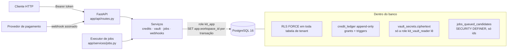
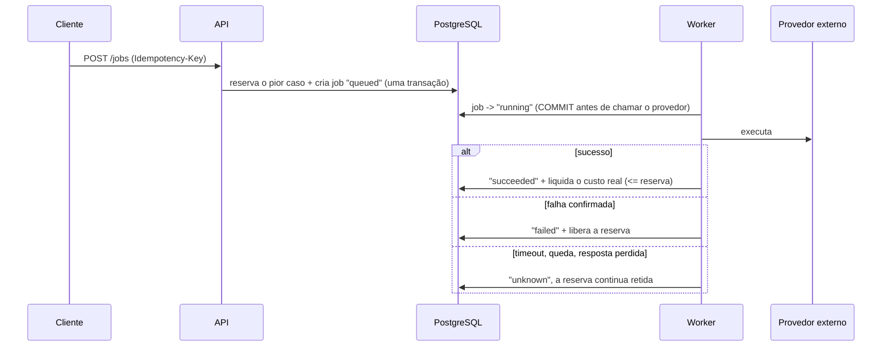

# saas-multitenant-kit

Esqueleto pequeno, mas funcional, de backend SaaS multi-tenant em Python. Ele reúne os padrões que mais pesam quando um produto passa a guardar dados de vários clientes e a cobrar por uso: isolamento no banco, crédito pré-pago, webhooks de pagamento, cofre de credenciais e tarefas em background.

O kit condensa padrões de produtos SaaS que o autor construiu. Os nomes, as regras de negócio e os detalhes internos desses produtos ficaram de fora. O domínio aqui é genérico: **workspaces**, **members** e um recurso medido, os **jobs**.

Stack: Python 3.11+, FastAPI, SQLAlchemy 2 assíncrono, Alembic, PostgreSQL 16 e pytest.

## O problema

Em um SaaS multi-tenant, os incidentes mais caros costumam vir de poucos lugares:

- **Vazamento entre clientes.** Basta uma consulta sem `WHERE tenant_id = ...` para um cliente ver dados de outro.
- **Dinheiro inconsistente.** Saldo que diverge do histórico, cobrança em dobro quando o provedor reenvia um webhook, gasto acima do que o cliente pagou.
- **Credenciais expostas.** Chaves de clientes devolvidas pela API, gravadas em log ou repassadas a quem não deveria vê-las.
- **Ações repetidas.** Um worker que tenta de novo depois de um timeout pode cobrar ou executar duas vezes algo que já tinha acontecido.

Cada seção abaixo mostra como o kit trata um desses riscos, com testes que provam o comportamento contra um PostgreSQL real.

## Arquitetura



Fluxo de um job medido:



## Decisões principais e por quê

### 1. Isolamento no PostgreSQL, não só na aplicação

Toda tabela com dados de cliente tem **Row Level Security habilitada e forçada** (`FORCE ROW LEVEL SECURITY`). A política compara `workspace_id` com a configuração `app.workspace_id`, que a aplicação define **dentro de cada transação** (`set_config(..., true)`), num listener `after_begin` (`app/db.py`).

- **Por que no banco:** filtros manuais espalhados pelo código falham em silêncio. Basta esquecer um deles para vazar dados. Com RLS, a consulta que esquece o filtro devolve zero linhas.
- **Por que `FORCE`:** sem ele, o dono da tabela ignora as políticas. A API conecta como `kit_app`, uma role **que não é dona das tabelas, não é superusuária e não tem `BYPASSRLS`**. As migrations rodam com outra role, a dona.
- **Por que por transação:** a configuração some no fim da transação, então uma conexão reaproveitada do pool nunca carrega o tenant da requisição anterior.
- **Falha fechada:** sem tenant definido, o valor vazio vira `NULL` e nada casa. Um valor malformado quebra no cast para `uuid`.
- **Sem bypass:** nem o cadastro nem o webhook precisam contornar o RLS. O cadastro escolhe o id do workspace antes de inserir e fixa esse id na transação. O worker descobre jobs pendentes por uma função `SECURITY DEFINER` estreita, que devolve apenas ids, e processa cada job numa transação do próprio tenant.

Testes (`tests/test_pg_rls.py`): consulta sem filtro, consulta "com bug" que pede o tenant B estando em A, insert, update e troca de tenant bloqueados, contexto que não vaza pelo pool e conferência no catálogo de que a role da aplicação não consegue contornar o RLS.

### 2. Crédito pré-pago: reservar o pior caso

Antes de qualquer trabalho medido, o serviço **reserva o custo máximo possível** (`credits.reserve`). Ao terminar, **liquida o custo real**, que nunca pode passar da reserva (`settle`). Se a falha for confirmada, **libera** a reserva (`release`).

- **Por que o pior caso:** cobrar só depois deixa o cliente gastar o que não tem, e checar o saldo antes sem reservar permite que dez requisições simultâneas gastem o mesmo último centavo. Com a reserva, `disponível = saldo - reservas retidas` nunca fica negativo.
- **Concorrência:** as operações de um workspace são serializadas com `pg_advisory_xact_lock`. O teste dispara dez reservas em paralelo contra um saldo que comporta três, e exatamente três passam.
- **Custo acima da reserva:** é recusado. A reserva continua retida para alguém decidir, em vez de virar saldo negativo em silêncio.
- **Valores em centavos inteiros**, sem `float`.

### 3. Ledger append-only, saldo derivado

`credit_ledger` só recebe `INSERT`. O saldo é `SUM(amount_cents)`; não existe coluna de saldo que possa divergir do histórico.

- **Duas camadas:** a role da aplicação não tem `UPDATE`, `DELETE` nem `TRUNCATE` (grants), e um trigger recusa essas operações **até para a dona da tabela**. Correção se faz com um novo lançamento de ajuste, nunca editando o passado.
- **Saldo nunca negativo:** um constraint trigger `DEFERRABLE INITIALLY DEFERRED` confere a soma no commit.
- **Idempotência:** `UNIQUE (workspace_id, kind, reference_id)`. A mesma referência de pagamento nunca credita duas vezes, e a mesma reserva nunca é liquidada duas vezes.
- Reserva encerrada fica congelada por trigger e não pode ser reaberta.

### 4. Webhooks assinados e idempotentes

`POST /webhooks/payments` valida a assinatura no esquema do header `Stripe-Signature` (`t=...,v1=...`, HMAC-SHA256 sobre `"{t}.{corpo bruto}"`). A verificação foi implementada localmente e é testável sem rede (`app/services/webhooks.py`).

- **Corpo bruto:** reserializar o JSON muda os bytes e quebra a assinatura.
- **Janela de tempo** contra replay de requisição capturada, **comparação em tempo constante** e aceitação de vários `v1` durante a rotação do segredo.
- **Idempotência pelo próprio INSERT:** o id do evento entra com `ON CONFLICT DO NOTHING` **na mesma transação** que credita o ledger. Ou os dois são gravados, ou nenhum é. Se o processamento falhar, o evento não fica marcado como visto e o reenvio do provedor processa de novo. Um evento já processado vira no-op.
- O crédito também usa como chave o id da sessão de checkout, o que cobre dois eventos *diferentes* para o mesmo pagamento.

### 5. Jobs at-most-once, sem nova tentativa automática

O executor grava `running` e **faz commit antes** de chamar qualquer coisa externa. A partir daí, as únicas saídas são estados terminais: `succeeded`, `failed` ou `unknown`.

- **Por quê:** um timeout não prova que o outro lado não executou. Tentar de novo pode cobrar duas vezes ou repetir uma ação (enviar, reservar, publicar). Quando o resultado é incerto, o job vai para `unknown`, a reserva de crédito continua retida e a decisão fica com uma pessoa ou com uma conciliação capaz de consultar o provedor.
- `failed` só existe quando o handler **sabe** que nada cobrável aconteceu (`JobFailed`). Nesse caso a reserva é liberada.
- Um worker que morre deixa jobs `running` que `reconcile_stale` marca como `unknown`, sem reenfileirar.
- Para tentar de novo, o cliente cria um job novo com outra `Idempotency-Key`, por decisão explícita.
- A máquina de estados existe em Python e **também no banco** (trigger `jobs_transition`): nenhum caminho leva de volta a `queued`.
- Dois workers disputando o mesmo job: `SELECT ... FOR UPDATE SKIP LOCKED` e checagem de status garantem um único despacho (teste incluído).

### 6. Cofre de credenciais fora do alcance da API

- **Cifragem em repouso** com AES-256-GCM e chaves versionadas lidas do ambiente (`VAULT_KEYS`, `VAULT_ACTIVE_KEY`). Não há chave padrão nem modo texto puro: sem chave, o cofre fica indisponível.
- **Dados associados (AAD)** amarram cada ciphertext a workspace, id do segredo e versão. Copiar o ciphertext para outra linha ou outro tenant o torna indecifrável.
- **A API nunca devolve o valor.** Só existem criar, substituir, revogar e listar metadados; não há endpoint de "revelar".
- **Nem a role da aplicação lê o ciphertext:** o grant de `SELECT` é por coluna e exclui `ciphertext`. Só `app/services/vault.py` lê, trocando para a role `kit_vault_reader` (concedida `WITH INHERIT FALSE`, recurso do PostgreSQL 16) por um único comando. Qualquer outro ponto do código que tente ler a coluna recebe `permission denied`.
- O executor carrega os segredos que o handler declara; o valor nunca entra no input do job, e o resultado passa por redação antes de ser gravado. Cada uso fica registrado em `vault_events`, que é append-only.
- Rotação: `vault_crypto.reseal` recifra com a chave ativa e mantém legíveis os envelopes antigos.

## Como rodar

Pré-requisitos: Python 3.11+ e Docker.

```bash
python3 -m venv .venv && .venv/bin/pip install -e ".[dev]"
docker compose up -d --wait db           # PostgreSQL 16 em localhost:54329

cp .env.example .env                     # gere uma chave real para VAULT_KEYS
set -a; . ./.env; set +a
.venv/bin/alembic upgrade head           # roda como a role dona; cria kit_app e as políticas
.venv/bin/uvicorn app.main:app --reload  # API
.venv/bin/python -m app.services.jobs    # worker (em outro terminal)
```

Testes:

```bash
.venv/bin/pytest -q          # unitários sempre rodam; os de banco precisam do docker compose
.venv/bin/ruff check .
```

Os testes de banco criam uma base descartável (`kit_test`), aplicam a migration como dona e se conectam como `kit_app`, exatamente como a API. Sem PostgreSQL acessível, eles são pulados. No CI (`KIT_REQUIRE_PG=1`), a falta do banco faz a suíte falhar.

## Estrutura

```
app/
  api/routes.py          camada HTTP fina: uma transação por requisição, presa ao tenant
  auth.py                token assinado mínimo (troque pelo seu provedor de identidade)
  config.py              configuração por ambiente, sem padrão para segredos
  db.py                  engine, sessão e fixação do tenant em cada transação
  models.py              mapeamento ORM (o schema real vive na migration)
  services/
    credits.py           reserva, liquidação, liberação e recarga idempotente
    jobs.py              enfileiramento, executor at-most-once e reconciliação
    vault.py             único módulo que lê ciphertext
    vault_crypto.py      envelope AES-GCM, keyring e rotação
    webhooks.py          verificação de assinatura e processamento idempotente
migrations/versions/     roles, tabelas, RLS, grants e triggers
tests/                   test_unit_* (sem banco) e test_pg_* (PostgreSQL real)
docker-compose.yml       PostgreSQL 16 local
.github/workflows/ci.yml ruff + pytest com serviço postgres:16
```

## Limites conhecidos

- RLS protege contra erro de aplicação, não contra comprometimento total do servidor ou da role dona.
- A autenticação é um token HMAC de demonstração. Em produção, use um provedor de identidade; o contrato que importa é que o tenant vem de uma credencial verificada.
- Jobs em `unknown` pedem conciliação. O kit marca e retém o crédito, mas a resolução depende de cada provedor.
- Um único `UNIT_PRICE_CENTS` ilustra a medição. Preços reais devem vir de configuração ou de uma cotação gravada na reserva.

## Autor

Rafael Lins Gaspar · [rafaellinsrj.github.io](https://rafaellinsrj.github.io) · [linspartners.com](https://linspartners.com)

Licença MIT.

---

## English summary

**saas-multitenant-kit** is a compact, working multi-tenant SaaS backend (FastAPI, async SQLAlchemy 2, Alembic, PostgreSQL 16, pytest). It distills patterns from SaaS products the author built, with every product-specific detail removed.

What it demonstrates, each with tests against a real PostgreSQL:

- **Tenant isolation in the database.** RLS is enabled and forced on every tenant table. The tenant is set per transaction with `set_config(..., true)`. The app connects as a non-owner role without `BYPASSRLS`. There is no bypass path: sign-up pins the new id first, and the worker discovers work through a narrow `SECURITY DEFINER` function that returns ids only.
- **Prepaid credit.** The worst-case cost is reserved before work, the actual cost is settled afterwards (never above the hold), and the hold is released on confirmed failure. Per-workspace advisory locks prevent concurrent overspending.
- **Append-only ledger.** No UPDATE, DELETE or TRUNCATE, enforced through grants and through triggers that also stop the table owner. The balance is derived from the ledger, a deferred check keeps it non-negative, and unique references make every write idempotent.
- **Signed, idempotent webhooks.** Verification of the Stripe-compatible `t=,v1=` HMAC scheme is implemented locally and tested offline. The event id is recorded in the same transaction as the credit, so a replay is a no-op and a failed attempt can be retried.
- **At-most-once jobs.** The job is committed as `running` before dispatch, uncertain outcomes become `unknown` with the credit still on hold, and nothing is ever re-queued automatically. The state machine is enforced in Python and in the database.
- **Secrets vault.** Secrets use AES-256-GCM with a versioned keyring and AAD binding. The API returns metadata only, and the app role cannot SELECT the ciphertext column: only the vault service reads it, through a non-inherited reader role (PostgreSQL 16).

Run it with `docker compose up -d --wait db`, `alembic upgrade head`, then `pytest -q`. Author: Rafael Lins Gaspar ([rafaellinsrj.github.io](https://rafaellinsrj.github.io), [linspartners.com](https://linspartners.com)). MIT license.
